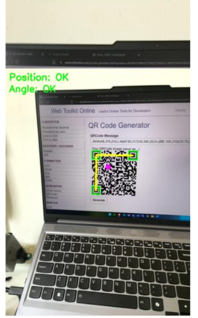
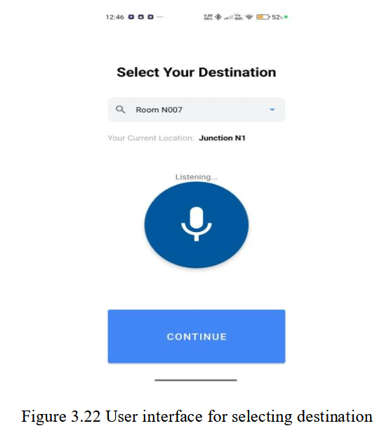
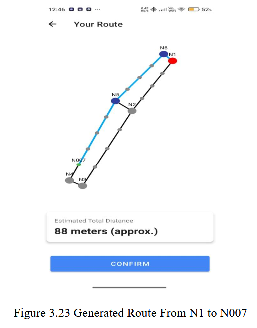
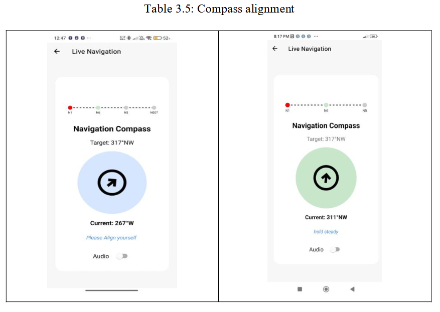
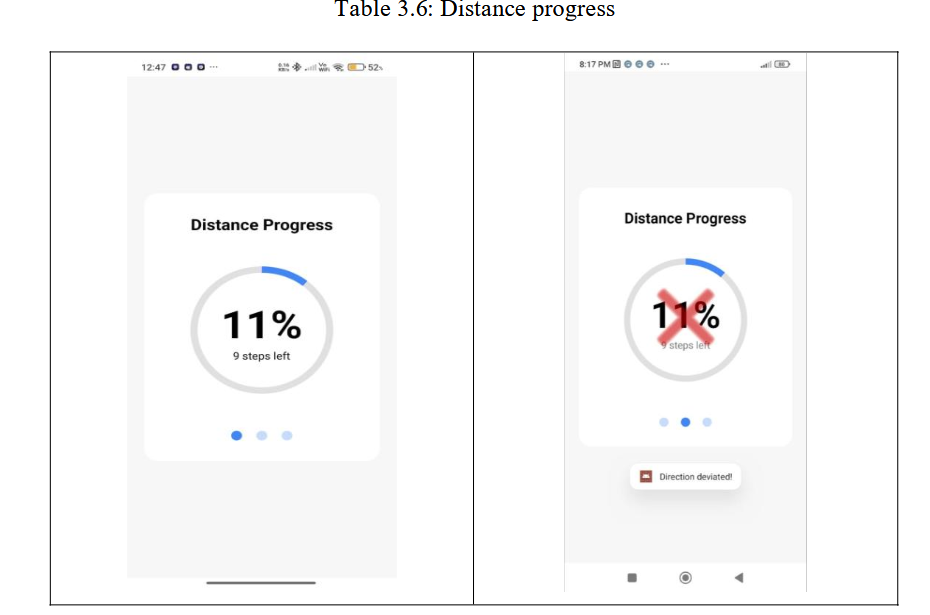
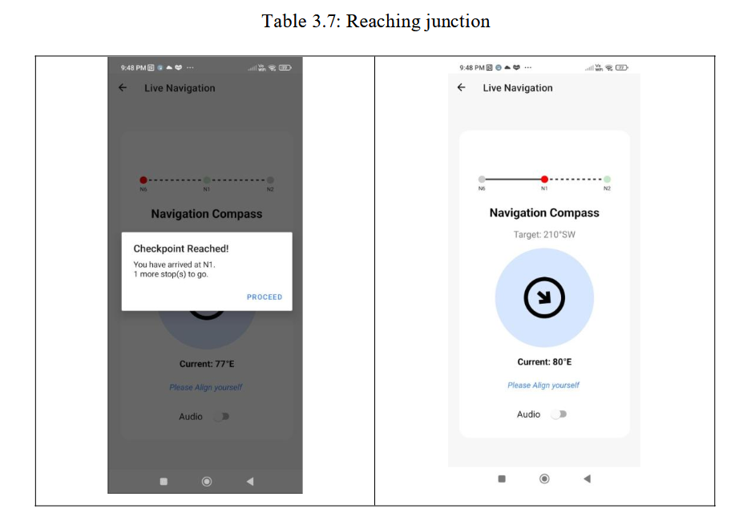
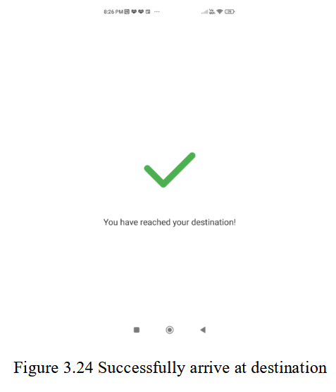
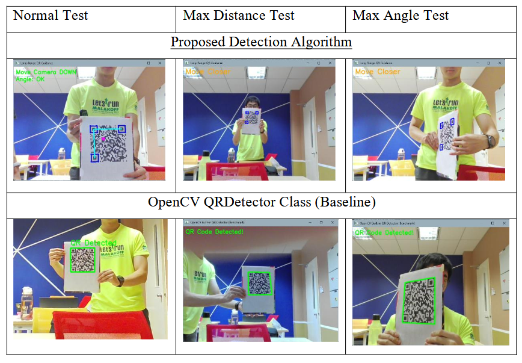

# Indoor Navigation for the Visually Impaired Using QR Codes

A smartphone-based indoor navigation prototype designed to help visually impaired users navigate indoor spaces more independently using QR codes, computer vision, turn-by-turn voice guidance, and haptic feedback.

## Tech Stack

          

### Additional Technologies

| Category        | Technology                                   | Usage                                                      |
| --------------- | -------------------------------------------- | ---------------------------------------------------------- |
| Pathfinding     | Dijkstra Algorithm                           | Computes the shortest route between navigation nodes       |
| Sensors         | Accelerometer, Magnetometer, Pedometer       | Supports motion tracking, orientation, and step estimation |
| Accessibility   | Text-to-Speech, Voice Input, Haptic Feedback | Delivers multimodal navigation guidance                    |
| Mobile Platform | Android                                      | Prototype developed and tested on Android devices          |

## Overview

Indoor navigation remains difficult for visually impaired users because GPS is unreliable indoors, while many existing solutions depend on expensive infrastructure or specialized hardware. This project proposes a low-cost and scalable alternative by using a standard Android smartphone, printed QR codes, and an offline navigation workflow that provides accessible multimodal guidance.

The system combines QR code detection, QR decoding, route planning, and navigation feedback into a single Android-based prototype. It is designed as a proof of concept for a constrained indoor environment and focuses on practical accessibility features such as voice input, text-to-speech output, haptic cues, and checkpoint-based position correction.

## Problem Statement

Visually impaired users often face significant challenges when navigating indoor environments independently. Unlike outdoor navigation, indoor spaces cannot rely on GPS effectively, and many current alternatives require costly infrastructure such as Bluetooth beacons or infrared systems. This creates a need for a more affordable, scalable, and user-friendly indoor navigation solution that improves independence and reduces reliance on others.

## Key Features

- QR-based indoor localization
- Offline map data embedded inside QR codes
- Custom QR detection algorithm
- Two-stage QR decoding pipeline
- Shortest-path routing using Dijkstra’s algorithm
- Voice input for destination selection
- Text-to-Speech navigation guidance
- Haptic feedback for directional assistance
- Checkpoint-based rescanning to reduce sensor drift
- Accessible Android interface for route confirmation and navigation progress

## What This Project Demonstrates

- Applied computer vision for assistive navigation
- Mobile app development on Android
- Native and hybrid development with Java and C++
- Accessible interaction design using audio and haptics
- Route planning using graph-based shortest-path algorithms
- Performance evaluation using distance, angle, and positioning metrics

## How It Works

### 1. Initial QR Scan

The user starts by scanning a QR code that initializes the navigation session. The system provides directional guidance while detecting the QR code and automatically proceeds once the QR code is successfully decoded.

### 2. Destination Selection

After decoding the QR code, the application allows the user to select a destination either through a dropdown menu or voice input.

### 3. Route Confirmation

The app displays the selected destination, current location, and total distance on a simple map view so the route can be confirmed before navigation begins.

### 4. Direction Alignment

The system uses compass-based alignment together with voice and haptic guidance to help the user face the correct direction before walking.

### 5. Walking Progress

As the user moves, the app tracks route progress and remaining steps. If the user deviates too far from the intended direction, the system prompts realignment.

### 6. Junction Confirmation

At each checkpoint or junction, the user scans another QR code to confirm their current position and receive the next navigation step. This helps correct accumulated sensor drift over longer distances.

### 7. Arrival Confirmation

At the destination, the user performs a final QR scan and the interface confirms successful arrival.

## Technical Highlights

### Compact Offline QR Map Encoding

The system stores the entire navigable map inside a QR code using a compact encoded format. This enables offline navigation without depending on cloud connectivity or server-side lookups.

### Custom QR Detection Algorithm

A custom QR detection pipeline was developed to improve detection range and angle tolerance beyond standard libraries such as ZBar and OpenCV. The algorithm uses contour hierarchy checks, geometric validation, and multi-stage processing to improve robustness.

### Two-Stage QR Decoding Pipeline

The decoder first attempts a direct decode and only applies perspective correction and image enhancement when necessary. This balances performance and robustness while improving decoding success under distortion and blur.

### Multimodal Accessibility

The navigation experience is built around text-to-speech, haptic cues, and voice input so users can interact with the system without depending on visual feedback alone.

## Performance Summary

The following tables summarize the main evaluation results reported for QR detection, navigation accuracy, and algorithm comparisons.

### QR Detection and Decoding Performance

| Test Condition          | Avg Detection Distance (m) | Avg Decoding Distance (m) |
| ----------------------- | --------------------------:| -------------------------:|
| Clean Background, 0°    |                       1.70 |                      0.80 |
| Clean Background, 45°   |                       1.40 |                      0.70 |
| Complex Background, 0°  |                       1.85 |                      0.88 |
| Complex Background, 45° |                       1.43 |                      0.63 |

These evaluation tables show that QR codes were detected in the range of 1.38 m to 1.87 m, while successful decoding generally occurred between 0.62 m and 0.90 m under the reported test conditions.

### Position Accuracy Testing

| Path                     | Actual Distance (m) | Recorded Distance (m) | Error (m) |
| ------------------------ | -------------------:| ---------------------:| ---------:|
| N012 to Junction 5       |                  38 |                    37 |       1.0 |
| N007 to Junction 5       |                  42 |                    40 |       2.0 |
| N008 to Junction 2       |                  40 |                  39.5 |       0.5 |
| Junction 1 to Junction 6 |                   6 |                   5.5 |       0.5 |
| N001 to Junction 4       |                  83 |                    80 |       3.0 |

| Metric                        | Result |
| ----------------------------- | ------:|
| Root Mean Square Error (RMSE) | 1.70 m |

The reported positioning results indicate that the prototype was able to guide users close to intended destinations with an overall RMSE of 1.70 m.

### Pathfinding Accuracy Testing

| Path                     | Actual Distance (m) | Recorded Distance (m) |
| ------------------------ | -------------------:| ---------------------:|
| N012 to Junction 5       |                  38 |                    38 |
| N007 to Junction 5       |                  42 |                    42 |
| N008 to Junction 2       |                  40 |                    40 |
| Junction 1 to Junction 6 |                   6 |                     6 |
| N001 to Junction 4       |                  83 |                    83 |

| Summary                           | Result                                  |
| --------------------------------- | --------------------------------------- |
| Shortest-path generation accuracy | 5 / 5 routes matched expected distances |

The evaluation states that the Dijkstra implementation consistently produced the expected shortest path across all tested routes.

### QR Detection Algorithm Comparison

| Method          | Max Detection Distance (m) | Max Angle Tolerance (°) | Distance Improvement (%) | Angle Improvement (%) |
| --------------- | --------------------------:| -----------------------:| ------------------------:| ---------------------:|
| ZBar            |                       1.64 |                      30 |                    40.24 |                116.67 |
| OpenCV          |                       1.01 |                      40 |                   127.72 |                 62.50 |
| Proposed Method |                       2.30 |                      65 |                        - |                     - |

### QR Decoding Pipeline Comparison

| Test Condition      | Baseline (ZBar Only) | Proposed Technique | Improvement (%) |
| ------------------- | --------------------:| ------------------:| ---------------:|
| Max Angle Tolerance |                  19° |                61° |          221.05 |
| Max Blur Tolerance  |                  97% |               104% |            7.22 |

These comparisons show the strongest technical contribution of the project: the proposed QR detection and decoding workflows outperformed baseline approaches in both detection robustness and decoding tolerance.

## Future Improvements

- Dynamic rerouting when the wrong QR code is scanned
- Obstacle detection and avoidance
- Improved handling of poor lighting and multiple QR codes in view
- Cross-platform support
- Better optimization for lower-end mobile hardware
    
## Disclaimer

This project was developed as an academic prototype and evaluated in a controlled indoor environment. It is intended to demonstrate the feasibility of low-cost smartphone-based indoor navigation for visually impaired users.
